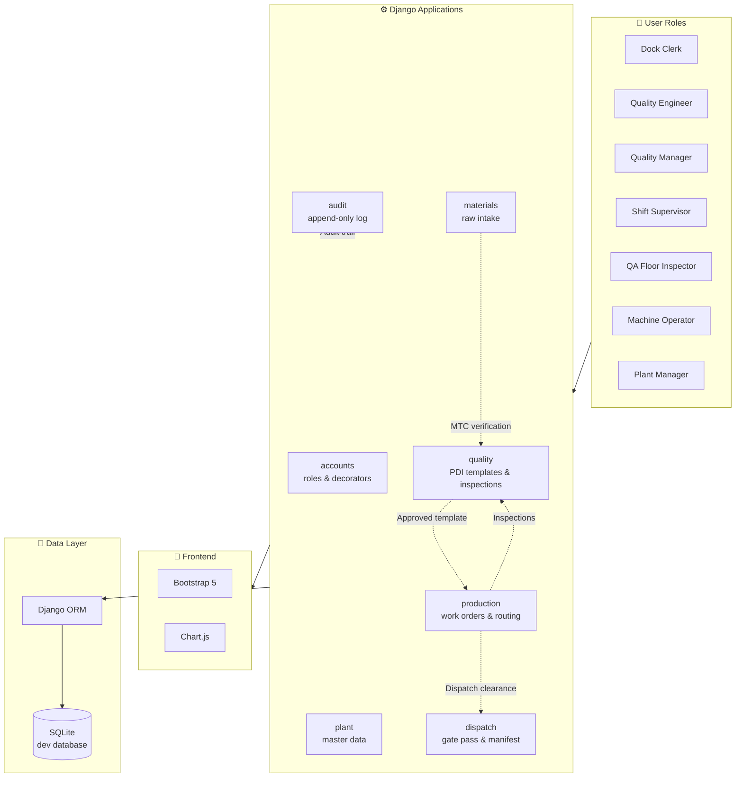
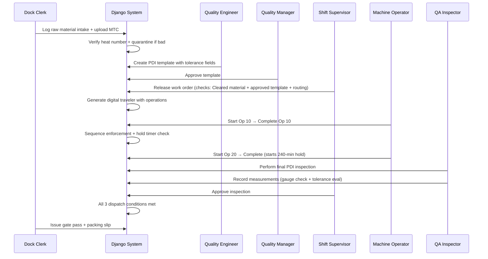
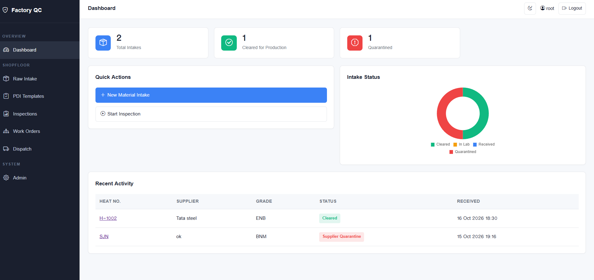
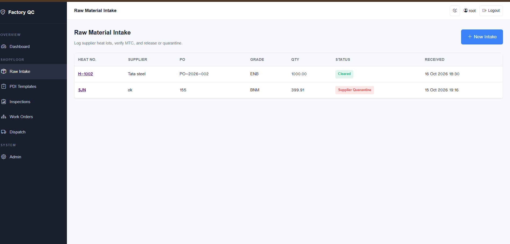
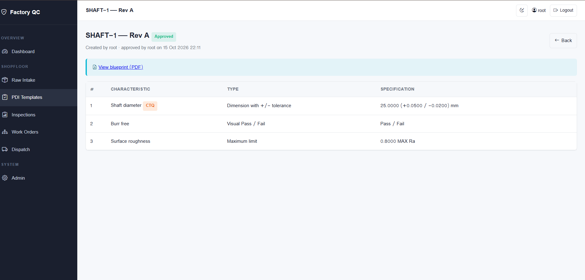
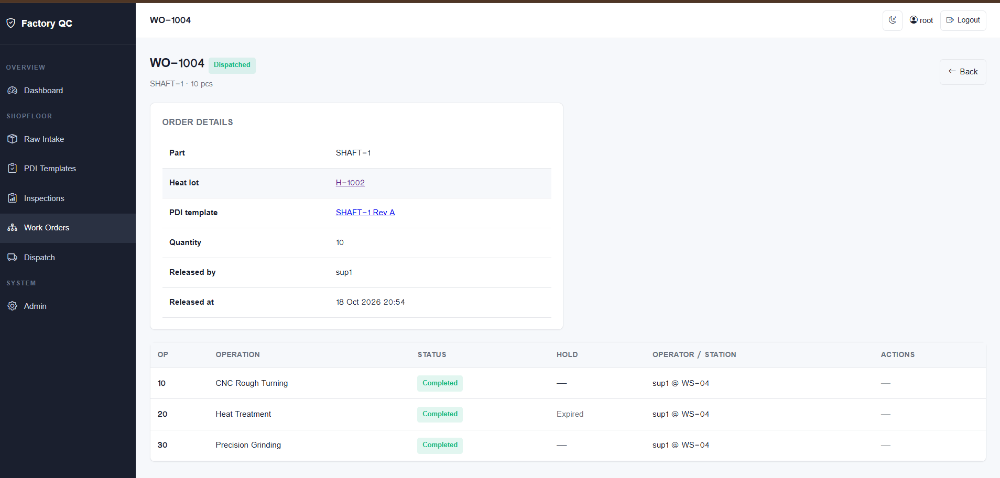
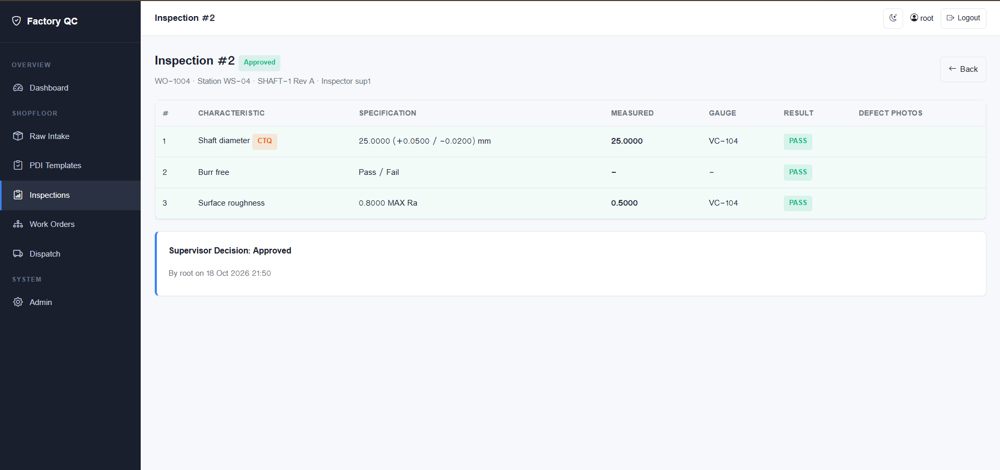
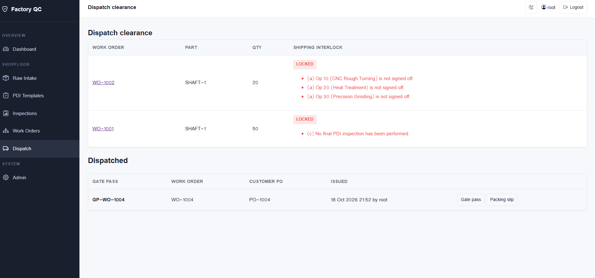
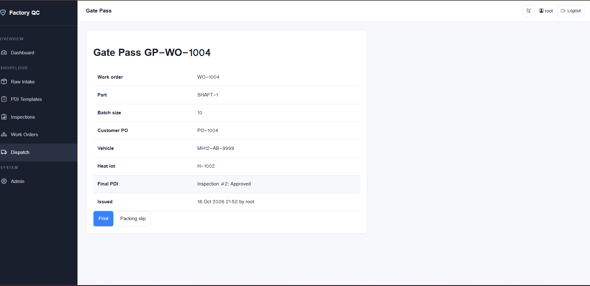

<div align="center">

# 🏭 Factory Operations & Quality Control System

**A Django-based shopfloor quality assurance, in-process tracking, and dispatch clearance system — built from a 17-page Business Requirements Document.**

[](https://www.python.org/)
[](https://www.djangoproject.com/)
[](https://sqlite.org/)
[](https://getbootstrap.com/)
[](LICENSE)
[]()

### 🎥 [Watch the Live Video Demo Here](https://youtu.be/z3BZsnMA4NY)

*"Every finished item is permanently linked to its raw material heat lot, mill certificate, CNC program version, machine operator ID, measurement tool calibration number, and supervisor sign-off timestamp."* — BRD §1.1

</div>

---

## 📋 Table of Contents

- [Overview](#-overview)
- [System Architecture](#-system-architecture)
- [Core Modules](#-core-modules)
- [Feature Coverage (BRD Mapping)](#-feature-coverage-brd-mapping)
- [Tech Stack](#-tech-stack)
- [Getting Started](#-getting-started)
- [Demo Walkthrough](#-demo-walkthrough)
- [Screenshots](#-screenshots)
- [Project Structure](#-project-structure)
- [Assumptions](#-assumptions)
- [Limitations & Future Scope](#-limitations--future-scope)
- [Interview Notes](#-interview-notes)
- [License](#-license)

---

## 🎯 Overview

This system replaces **paper clipboards, loose inspection sheets, hand-written traveler cards, and verbal handoffs** on the manufacturing floor with a rugged, tablet-friendly digital workflow.

**Mission:** Enforce a locked digital boundary at every workstation. No job lot moves to the next machine, enters heat treatment, or leaves the factory gate unless every dimension, material certificate, process hold time, and supervisor sign-off is **100% complete and verified**.

### The Problem Being Solved

| Paper-Based Problem | Digital Solution |
|---|---|
| Illegible handwriting on inspection sheets | Numeric tolerance input with instant PASS/FAIL validation |
| Lost job traveler cards | Digital traveler auto-generated at work order release |
| Delayed supervisor reviews | Live approval queue with role-based access |
| Bad parts machined further or shipped | Server-side interlocks block downstream operations and dispatch |
| No traceability for recall | Forward/backward traceability via heat number and serial number |
| No tool calibration control | Gauge expiry check blocks measurement  |

---

## 🏗 System Architecture



### Data Flow: From Dock to Dispatch



---

## 🧩 Core Modules

### 🔐 `accounts` — Role-Based Access Control
8 shopfloor roles mapped to Django Groups. Custom `@role_required` decorator enforces permissions server-side (never trust the UI). Superusers bypass all role checks for administrative access.

### 📜 `audit` — Append-Only Audit Trail
Every state-changing action writes an immutable row: user, timestamp, action, object type, old value, new value, IP address. Admin panel is read-only. Custom QuerySet blocks bulk `update()` and `delete()` to prevent bypass.

### 🏭 `plant` — Master Data
Factories, workstations (with QR-plate codes), parts, and measurement gauges (with calibration expiry tracking). Managed exclusively through Django admin.

### 📦 `materials` — Raw Material Intake
Dock receiving workflow with MTC upload, heat-number verification, lab testing state, and automatic Supplier Non-Conformance Report (SNCR) creation on rejection. Email alerts to Quality.

### ✅ `quality` — PDI Templates & Inspections
- **Templates:** Revision-controlled checklists (Rev A, B, C...) with 4 field types: Tolerance, Maximum, Minimum, Pass/Fail. CTQ flagging. Blueprint PDF attachment.
- **Workflow:** Draft → Pending → Approved. QE creates, QM approves. Only one approved revision per part (enforced by database constraint).
- **Inspections:** Tablet-based measurement entry with mandatory gauge scanning, server-side tolerance evaluation, defect photo capture (2 minimum), and CTQ freeze on critical failures.

### ⚙️ `production` — Work Orders & Routing
Digital traveler generation from master routing. Sequence enforcement (Op 10 → 20 → 30). Mandatory hold timers after designated operations (e.g., 240 min cooling after Heat Treatment). Machine PM overdue lock.

### 🚚 `dispatch` — Shipping Interlock
Three-rule clearance check: all operations signed off + all holds expired + latest inspection approved. Gate pass, packing slip, and manifest generation only after clearance.

---

## 📊 Feature Coverage (BRD Mapping)

| # | BRD Section | Feature | Status |
|---|---|---|---|
| 1 | §2.1 | Master digital factory structure (Factory, Workstation, Part, Gauge) | ✅ |
| 2 | §2.2 | Machine PM overdue lock | ✅ |
| 3 | §2.3 | Gauge calibration enforcement | ✅ |
| 4 | §3.1 | Raw material intake with supplier + PO + heat number | ✅ |
| 5 | §3.2 | MTC upload + heat number verification | ✅ |
| 6 | §3.3 | Supplier Non-Conformance (SNCR) + quarantine | ✅ |
| 7 | §4.1 | PDI template revisions + approval workflow | ✅ |
| 8 | §4.2 | Tolerance fields (tolerance, max, min, pass/fail) | ✅ |
| 9 | §4.3 | CTQ priority tagging + freeze on failure | ✅ |
| 10 | §5.1 | Station code + job code entry (no browse-all) | ✅ |
| 11 | §5.2 | Locked step-by-step measurement entry | ✅ |
| 12 | §5.3 | Instant tolerance warnings | ✅ |
| 13 | §5.4 | Mandatory defect photo capture (2 minimum) | ✅ |
| 14 | §6.1 | Supervisor approval / concession / rejection | ✅ |
| 15 | §6.3 | MRB disposition (rework, scrap, RTV, customer concession) | ✅ |
| 16 | §7.1 | Digital traveler with operation sequence | ✅ |
| 17 | §7.2 | Forward/backward traceability via heat number | 📋 Planned |
| 18 | §8.1 | Mandatory hold timers | ✅ |
| 19 | §8.2 | Hold timer interlock blocks next operation | ✅ |
| 20 | §8.3 | Live shopfloor bottleneck monitoring | 📋 Planned |
| 21 | §9.1 | First-piece quality inspection | 📋 Planned |
| 22 | §9.2 | Frequency-based hourly sampling | 📋 Planned |
| 23 | §10.1 | Three-rule dispatch interlock | ✅ |
| 24 | §10.2 | High-visibility lockout with reason | ✅ |
| 25 | §11 | Dispatch manifest + customer QR labels | ✅ / 📋 |
| 26 | §12 | Role-based access + shift handover logs | ✅ / 📋 |
| 27 | §13.3 | Tamper-proof append-only audit trail | ✅ |
| 28 | §7.2 | Offline caching for tablets | 📋 Future |

**Legend:** ✅ Implemented · 📋 Planned

---

## 🛠 Tech Stack

| Layer | Technology | Why |
|---|---|---|
| **Backend** | Django 5.2 | Batteries-included, ORM, admin, security defaults |
| **Language** | Python 3.14 | Latest stable, type hints, dataclass support |
| **Database** | SQLite (dev) | Zero-config local dev, easy to run anywhere |
| **Frontend** | Django Templates + Bootstrap 5 | Server-rendered, no SPA complexity per BRD restriction |
| **Charts** | Chart.js | Lightweight doughnut / KPI visuals |

**No React. No FastAPI. No microservices.** — per assignment constraints.

---

## 🚀 Getting Started

### Prerequisites
- Python 3.12+ (tested on 3.14)
- Git
- A terminal (CMD / PowerShell / Bash)

### Installation

```bash
# 1. Clone the repository
git clone https://github.com/SKM2227229725/factory-qc-system.git
cd factory-qc-system

# 2. Create and activate virtual environment
python -m venv venv
venv\Scripts\activate           # Windows
# source venv/bin/activate      # macOS / Linux

# 3. Install dependencies
pip install -r requirements.txt

# 4. Configure environment variables
copy .env.example .env          # Windows
# cp .env.example .env          # macOS / Linux
# Edit .env and set a SECRET_KEY

# 5. Run migrations
python manage.py migrate

# 6. Create an admin user
python manage.py createsuperuser

# 7. Start the development server
python manage.py runserver
```

Open http://127.0.0.1:8000/ and log in.

### Quick Setup Checklist

After first login, create the following in Django admin:

1. **Groups** `Dock Clerk`, `Quality Engineer`, `Quality Manager`, `Shift Supervisor`, `QA Floor Inspector`, `Machine Operator`, `Plant Manager`, `Warehouse Clerk`
2. **Factory** — e.g., `Main Machining Shop`
3. **Workstation** — e.g., `WS-04 / CNC Lathe 04` (Set PM due date in future)
4. **Part** — e.g., `SHAFT-1`
5. **Routing steps** for the part — Op 10, 20, 30
6. **Gauge** — e.g., `VC-104 / Vernier Caliper` (Calibration expiry in future)
7. **Users** assigned to roles

---

## 🎬 Demo Walkthrough (End-to-End Verified)

A complete flow verified on 18 Oct 2026:

### Step 1: Raw Material Intake
Login as a Dock Clerk (or admin) → `/intake/new/` → Fill supplier, PO, grade, heat number `H-1002`, quantity → Upload MTC PDF → Tick *"Heat number verified"* → **Save** → **Clear for Production**.

### Step 2: PDI Template
Login as Quality Engineer → `/pdi/new/` → Select `SHAFT-1`, Rev `A` → **Create Draft** → Add fields (Shaft diameter 25 +0.05/-0.02 CTQ, Burr free, Surface roughness Max 0.8 Ra) → **Submit for Approval**. 
Login as Quality Manager → **Approve**.

### Step 3: Work Order Release
Login as Shift Supervisor → `/work-orders/new/` → Number `WO-1004`, Part `SHAFT-1`, Heat lot `H-1002`, Qty 10 → **Release**.

### Step 4: Run Operations
Detail page → Op 10: enter station `WS-04` → **Start** → **Complete** → Op 20: **Start** → **Complete** → try Op 30 immediately → **blocked by hold timer**. 
*(Bypass hold via shell for demo).* → Op 30: **Start** → **Complete**.

### Step 5: Final Inspection
Login as QA Floor Inspector (or admin) → `/inspections/start/` → Station `WS-04`, Job `WO-1004` → Record 3 measurements with gauge `VC-104` (All PASS) → Submit.

### Step 6: Supervisor Approval
Login as Shift Supervisor (or admin) → Approve queue → **Approve**.

### Step 7: Dispatch
Login as Warehouse Clerk (or admin) → `/dispatch/` → `WO-1004` is **CLEARED** → Record manifest (PO, Vehicle, Serials) → **Gate pass issued** `GP-WO-1004`.

---

## 📸 Screenshots

> *End-to-end demo of the system.*

| Screen | Preview |
|---|---|
| **Dashboard (KPI + chart)** |  |
| **Raw Material Intake list** |  |
| **PDI Template detail** |  |
| **Work Order with traveler** |  |
| **Inspection entry (All PASS)** |  |
| **Dispatch Board (CLEARED)** |  |
| **Gate pass document** |  |
---

## 📁 Project Structure

```
factory_qc_system/
├── config/                    # Django project settings, URLs, WSGI
│   ├── settings.py
│   ├── urls.py
│   └── wsgi.py
├── accounts/                  # Role constants + @role_required decorator
│   ├── roles.py
│   └── decorators.py
├── audit/                     # Append-only audit log
│   ├── models.py
│   ├── services.py
│   └── admin.py
├── plant/                     # Factory, Workstation, Part, Gauge
│   ├── models.py
│   └── admin.py
├── materials/                 # Raw material intake + SNCR
│   ├── models.py
│   ├── services.py
│   ├── forms.py
│   ├── views.py
│   └── urls.py
├── quality/                   # PDI templates, inspections, reviews
│   ├── models.py
│   ├── services.py
│   ├── inspection_services.py
│   ├── review_services.py
│   ├── forms.py
│   ├── views.py
│   ├── inspection_views.py
│   ├── review_views.py
│   └── urls.py
├── production/                # Work orders, routing, operations
│   ├── models.py
│   ├── services.py
│   ├── forms.py
│   ├── views.py
│   └── urls.py
├── dispatch/                  # Shipping interlock + gate pass
│   ├── models.py
│   ├── services.py
│   ├── forms.py
│   ├── views.py
│   └── urls.py
├── templates/                 # Django templates (Bootstrap 5, sidebar layout)
│   ├── base.html
│   ├── home.html
│   ├── form_page.html
│   ├── registration/login.html
│   ├── materials/
│   ├── quality/
│   ├── production/
│   ├── inspections/
│   └── dispatch/
├── static/
│   └── css/app.css            # Custom styling (dark mode, sidebar, KPI cards)
├── manage.py
├── requirements.txt
├── .env.example
├── .gitignore
└── README.md
```

---

## 📝 Assumptions

The BRD leaves certain decisions open. The following assumptions were made and are documented here for transparency:

| # | Assumption | Rationale |
|---|---|---|
| 1 | One intake record per heat number (unique constraint) | Ensures unambiguous traceability |
| 2 | Gauge is valid through its expiry date inclusive | BRD does not specify whether the expiry day itself counts |
| 3 | A Cleared lot cannot be rejected at the dock | Post-clearance problems go through the quality/MRB flow |
| 4 | Only QE edits a Draft template; only QM approves or rejects it | Segregation of duties per BRD §12 |
| 5 | Approving a new revision supersedes the previous approved revision | Database constraint enforces one live revision per part |
| 6 | Tolerances are signed offsets from nominal, inclusive limits | Matches industry convention |
| 7 | Work orders release only against Cleared material + approved template + ≥1 routing step | Per BRD §3.3 and §4.1 |
| 8 | Shift Supervisors and Plant Managers release work orders | BRD does not specify who; chosen for operational flow |
| 9 | Station and job codes replace camera QR scanning | Browser camera integration is optional; typed codes work everywhere |
| 10 | Concession lot counts as Approved for dispatch | BRD §6.1 flags concession lots permanently but allows shipment |
| 11 | Operators can only complete their own operations | Prevents shift change mid-operation |
| 12 | Rejected inspections become the "latest inspection" until superseded | Rework requires a fresh inspection to be approved |
| 13 | Self-review is blocked (inspector ≠ reviewer) | Segregation of duties |

---

## ⚠️ Limitations & Future Scope

### Known Limitations

- **Traceability search (UI)** — Database fields exist, but a dedicated search page for heat number / serial lookup is not yet built.
- **Shift handover form** — Not implemented yet.
- **Offline caching** (BRD §7.2) — Tablets require network connection.
- **Blueprint pinning** (BRD §4.2) — Blueprints attach as static PDFs; interactive pinning is not implemented.
- **Partial shipments** — One dispatch per work order.
- **Serial numbers** — Typed manually, not validated against quantity.
- **Audit log tamper resistance** — Limited to Django-level guards (bulk `.update()` is blocked). A user with direct SQLite file access could edit rows.
- **Camera QR scan** — Typed codes are used instead. Browser camera integration is planned.

### Roadmap

- [x] **Phase 3C:** Inspection entry with defect photos
- [x] **Phase 4A:** Supervisor review, concession, MRB disposition
- [x] **Phase 4C:** Dispatch interlock, gate pass, manifest
- [ ] **Phase 5:** Full automated test suite
- [ ] **Phase 6:** Sample data command, traceability search, shift handover
- [ ] **Phase 7 (optional):** Camera QR, live bottleneck heatmap

---

## 🎤 Interview Notes

Key design decisions worth discussing:

### Why Django Templates, not React?
The BRD explicitly restricts to Django Templates. Server-rendered pages are simpler for a shopfloor tablet app where users need forms and confirmation, not SPA transitions.

### Why Decimal, not float?
Tolerance comparisons like `25.05 ≤ 25.00 + 0.05` must not fail due to floating-point rounding. `Decimal` gives exact arithmetic.

### Why services.py per app?
Business rules live in one function per workflow. Views, tests, admin commands, and future API endpoints all call the same service. Rules can't drift.

### Why `transaction.atomic`?
State changes and their audit entries commit together or not at all. Prevents inconsistent data.

### Why `@role_required` on the server?
Hiding a button is not security. A user can type the URL. The decorator raises `PermissionDenied` (HTTP 403) which is testable and auditable.

### Why partial unique constraints?
`UniqueConstraint(fields=["part"], condition=Q(status="APPROVED"))` allows at most one approved PDI template per part — even if service logic had a bug, the database would refuse a second one.

### How is sequence enforcement done?
`start_operation` calls `previous_operation()` and refuses if any earlier operation isn't `COMPLETED`. Server-side, not UI.

### How does the hold timer work?
`complete_operation` sets `hold_until = completed_at + hold_minutes`. `start_operation` refuses if `hold_until > now` and reports remaining minutes.

---

## 📜 License

MIT — free to use, modify, and learn from.

---

<div align="center">

**Built with ☕ and a 17-page BRD.**

[Report an issue](https://github.com/SKM2227229725/factory-qc-system/issues) · [View repository](https://github.com/SKM2227229725/factory-qc-system)

</div>
